<div align="center">

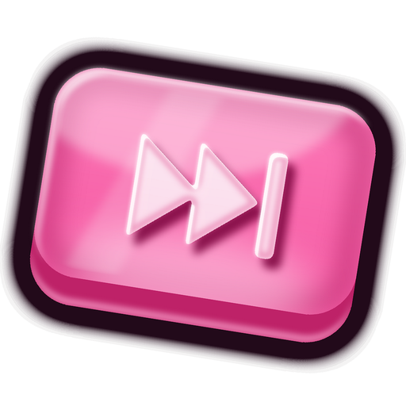

# Skip Dat

**Every music app's queue, one Alt + scroll away.**

Hold <kbd>Alt</kbd> and scroll anywhere in Windows. A glass wheel of your queue pops out of the cursor.<br>
Let go to play the song you landed on. That's it. That's the app.

<a href="../../releases/latest/download/SkipDat-setup.exe">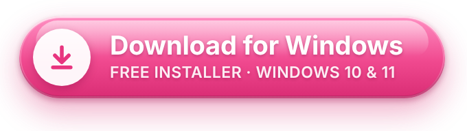</a>

<sub>Version 1.4.1 · Windows 10 and 11 · under 4 MB · installs without admin rights · <a href="../../releases">all versions</a></sub>

<br>

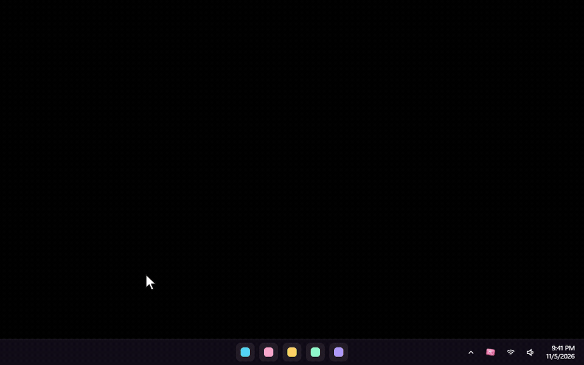

</div>

<br>

Works with **Spotify, Apple Music, YouTube Music, YouTube, SoundCloud** and other music players, all in one wheel. Chats, calls, social videos and ordinary YouTube videos are left out.

## New in 1.4.1

### Spotify, but it teleports

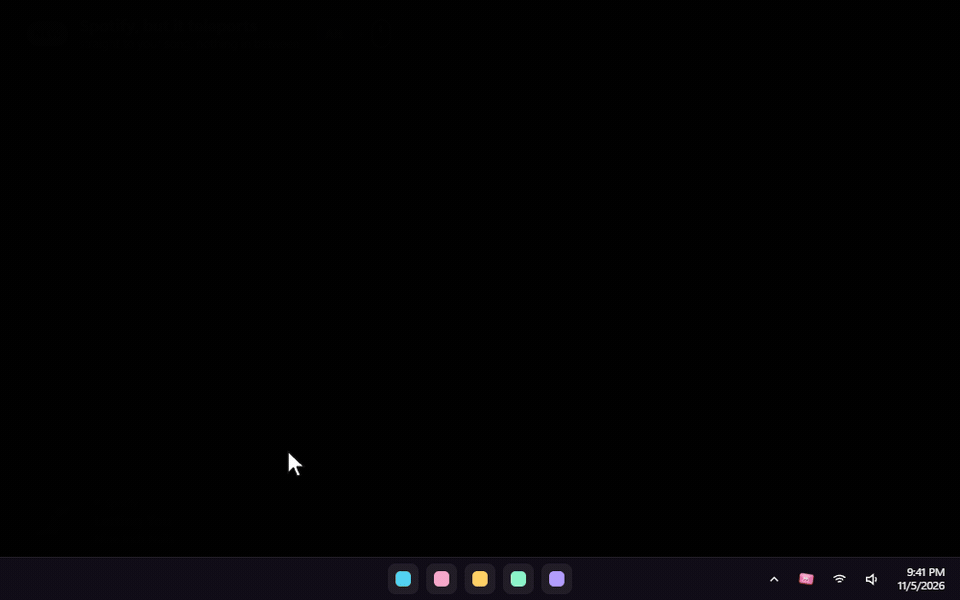

Pick a Spotify song four places down and Skip Dat jumps **straight to it**. You don't hear the songs in between, not even muted. It starts the song inside the playlist or album you're playing, and that list carries on as usual afterwards.

- This needs the optional **Spotify connection** in Settings (see [Good to know](#good-to-know)).
- Spotify can't start some lists (Liked Songs, artists, radio) at a particular song. For those, Skip Dat plays your song followed by the songs shown after it, in the same order.
- With shuffle on, Spotify may pick a new shuffle order after the jump.

### Back to …: undo for music

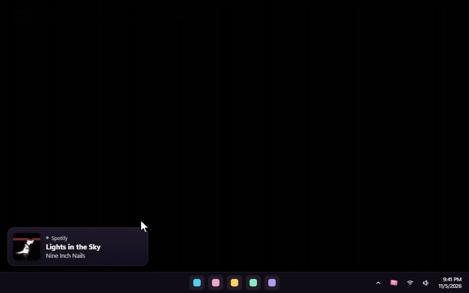

Under the play/pause button, **Back to …** shows the song you were playing before your last skip or jump. Skipped a banger by accident? Click it to go straight back. Click again to return.

### Also fixed

- **The song before the current one is the one you really played.** Spotify's "recently played" leaves out anything heard for less than 30 seconds, so the wheel often showed an older song. Songs Skip Dat only skipped past on the way don't count as played any more.
- **The history button on the carousel could freeze Skip Dat**, so it's gone. *What was I playing?* lives in Settings and the tray menu, and opening it from there no longer locks the app up.

Full list: [CHANGELOG.md](CHANGELOG.md).

## How to use it

### 1. Install it

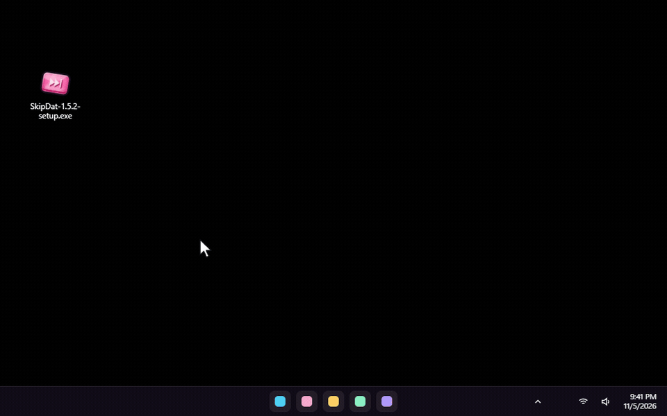

1. Download **SkipDat-setup.exe** with the button above and run it. It installs for your Windows account only, so Windows won't ask for an administrator.
2. If Windows says *"Windows protected your PC"*, click **More info**, then **Run anyway**. That shows up because the installer isn't code-signed yet.
3. Skip Dat starts in the **tray**, next to the clock. The first time, its Settings window opens by itself.

While installing you can also pick a Start menu shortcut, a desktop shortcut and "Start with Windows".

### 2. Hold Alt, scroll, let go

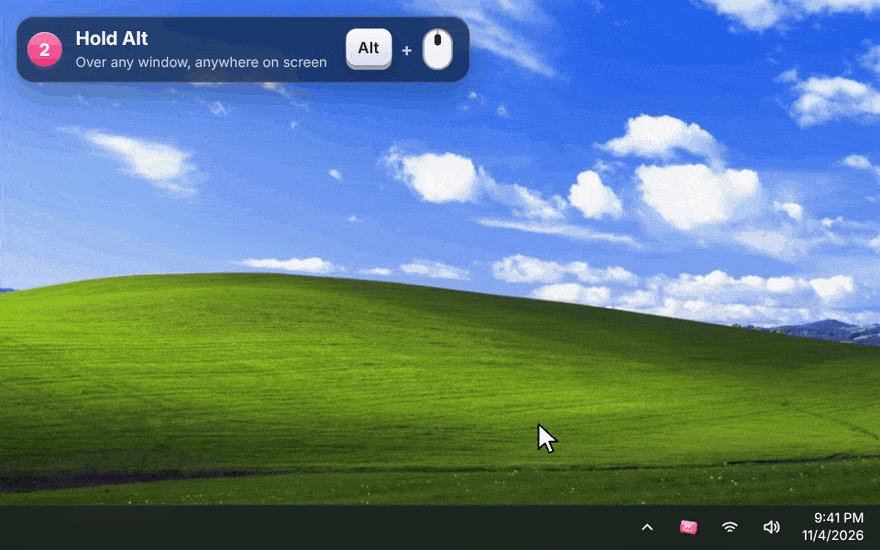

| Do this | What happens |
|---|---|
| **Hold <kbd>Alt</kbd>** and keep holding it | Nothing yet. Alt still works as usual everywhere. |
| **Scroll** the mouse wheel | The wheel opens at your cursor. Each notch moves one song. Scroll down for what's next, up for what already played. |
| **Let go of <kbd>Alt</kbd>** | The song in front plays and the wheel slips back into your cursor. If you didn't move off the song that's playing, nothing changes. |

### 3. While you hold: click, control, switch apps

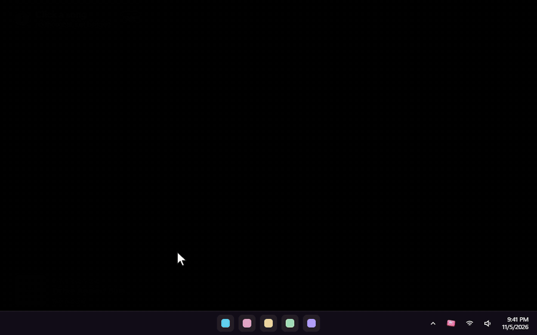

As long as you hold <kbd>Alt</kbd>, everything on the wheel is clickable:

- **Click any song** to play it straight away.
- **⏮ ⏯ ⏭** beside the wheel go back, play or pause, and skip.
- **Back to …** under them takes you to the song you were on before your last skip or jump.
- **Click an app's name** (YouTube Music, Spotify, SoundCloud...) to see that app's queue instead. The highlighted name is the app you're looking at.
- **Close without changing anything**: press <kbd>Esc</kbd> or click anywhere outside the wheel.

<details>
<summary><b>Keyboard and mouse shortcuts while holding</b></summary>

<br>

| | Vertical wheel | Horizontal wheel |
|---|---|---|
| Next / previous song | <kbd>↓</kbd> <kbd>↑</kbd> or the mouse wheel | <kbd>→</kbd> <kbd>←</kbd> or the mouse wheel |
| Switch app | <kbd>→</kbd> <kbd>←</kbd>, <kbd>Tab</kbd>, the mouse's side buttons, or tilting the wheel | <kbd>↓</kbd> <kbd>↑</kbd>, <kbd>Tab</kbd>, the mouse's side buttons, or tilting the wheel |
| Play or pause | <kbd>Space</kbd> or a middle click | <kbd>Space</kbd> or a middle click |
| Play the song in front | <kbd>Enter</kbd> | <kbd>Enter</kbd> |

</details>

### 4. Use your own shortcut

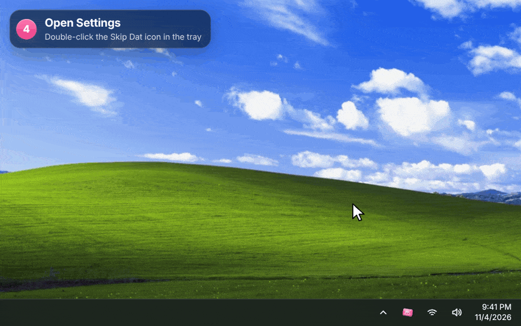

**Double-click the Skip Dat icon in the tray** to open Settings, then choose one under **Shortcut**. It works right away:

- <kbd>Alt</kbd> (the default), <kbd>Ctrl</kbd>, <kbd>Shift</kbd> or the <kbd>Windows</kbd> key
- <kbd>Ctrl</kbd> + <kbd>Alt</kbd>, <kbd>Ctrl</kbd> + <kbd>Shift</kbd> or <kbd>Alt</kbd> + <kbd>Shift</kbd>
- the **right mouse button**, or the mouse's **Back** or **Forward** side button. A normal click or drag with that button still works; it only opens the wheel when you scroll while holding it.

### 5. Pick a style

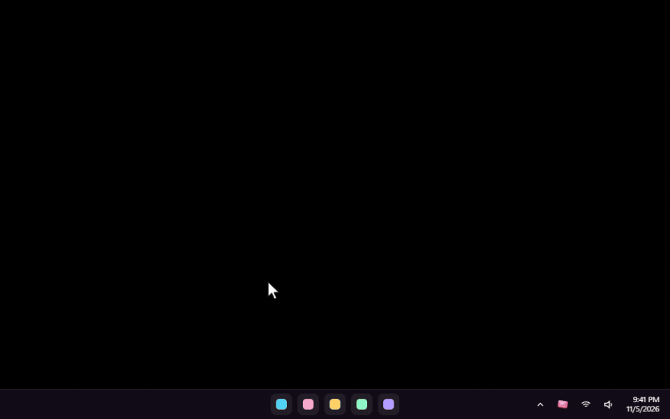

In Settings, under **Look**:

- **Style**: **Wheel** (cards on a turning drum, the default), **Stack** (a flat list of cards), **Cover flow** (a row, turned to face you), **Orbit** (a tilted ring of songs round your cursor, the far side blurred) or **Compact** (just the titles, small).
- **Wheel direction**, for the Wheel: **Vertical** stands beside your cursor; **Horizontal** lines the songs up in a row above it (below it near the top of the screen).
- **Size**: Small, Medium (the default) or Large.
- **Depth**: how much the songs away from the middle **blur** and **fade**. Both at 0 keeps every card sharp.

Every change applies at once, with no restart.

### 6. Skins

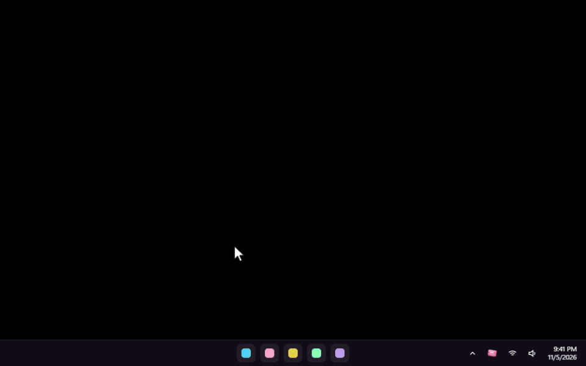

Pick one under **Settings → Skin**:

- **Liquid Glass**: the default, frosted glass over your desktop.
- **Lime Pod**: glossy lime plastic and chrome, a 2000s media player look.
- **LCD Night**: a green pocket-player screen with scanlines.
- **Brushed Chrome**: brushed metal and a pixel font.
- **Pixel Party**: an 8-bit cave, with grass and a pickaxe on top and a flickering torch.

**Make your own**: a skin is a folder with a `skin.json` file, plus any pictures and fonts it uses. **Open skins folder** in Settings takes you there, and a starter skin is waiting in it. Skip Dat watches the folder, so the carousel updates as you save. Everything you can change is in [SKINS.md](SKINS.md).

### 7. What was I playing?

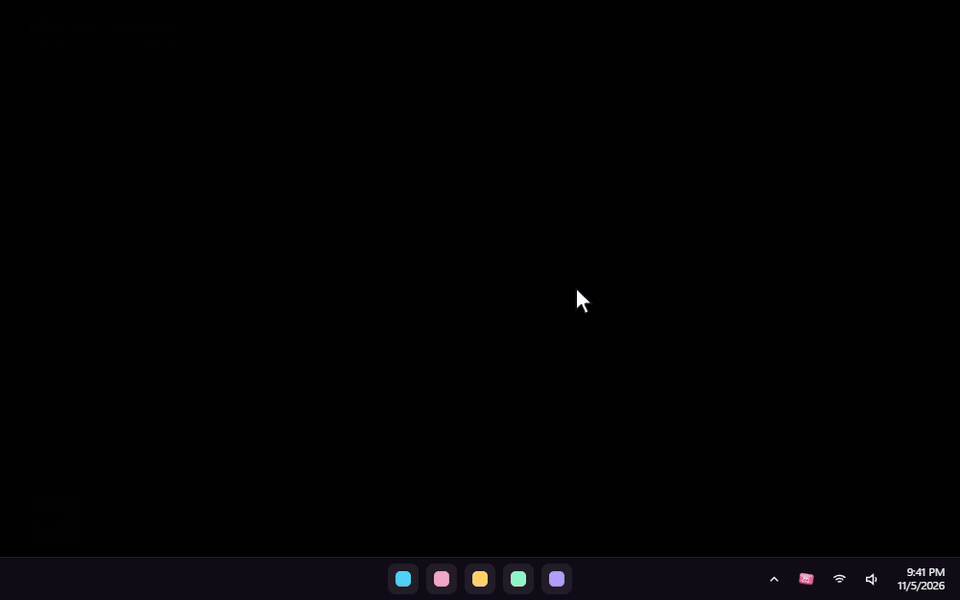

Right-click Skip Dat in the tray (or open Settings) and choose **What was I playing?** It lists the songs you listened to, newest first, with the app, the time and the cover. Click one to play it again. A song counts once it has played for a few seconds; songs Skip Dat only skipped past don't count. The list stays on your PC, and **Clear history** empties it.

### 8. YouTube Music, YouTube and SoundCloud: add the browser companion

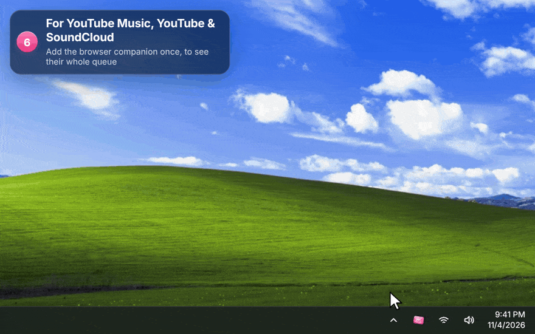

Music playing in a browser shows up in the wheel by itself, but only the song that's on. To see the **whole queue** of YouTube Music, YouTube and SoundCloud (playlists, mixes and radio included) and play any song in it, add the small companion extension once. It works in Chrome, Edge, Brave and Opera:

1. Open `chrome://extensions` in a new tab. In Edge it's `edge://extensions`.
2. Turn on **Developer mode**.
3. Click **Load unpacked** and choose the **browser-companion** folder. It's in `%LOCALAPPDATA%\Programs\Skip Dat`, and the **Show folder** button in Settings opens it.
4. Reload any music tab that was already open.

Settings shows **Connected** once a music tab has talked to Skip Dat.

## What it shows for each app

| App | Song that's on | Upcoming songs | Pick a song from the list |
|---|:---:|---|---|
| **YouTube Music** (with the companion) | ✓ | The whole Up next list: albums, playlists, mixes and radio, autoplay included | Plays it directly |
| **YouTube** playlist or mix (with the companion) | ✓ | The playlist or mix, growing as YouTube adds to it | Plays it directly |
| **YouTube** single video (with the companion) | ✓ | The one song autoplay will play next | Skips to it, muted on the way |
| **SoundCloud** (with the companion) | ✓ | The Next up list | Plays it directly (with shuffle on, skips to it muted, so the shuffle order stays) |
| **Spotify** app | ✓ | Only with the optional Spotify connection (see below) | **New in 1.4.1:** jumps straight to it when connected, inside your playlist or album; skips to it muted otherwise |
| **Apple Music** and other music apps | ✓ | Not shared by the app; you see the songs it played | Skips back through them, muted on the way |
| Music in a browser without the companion | ✓ | — | Skips, muted on the way |

Nothing is made up: when an app doesn't share what's next, the wheel shows what it played and what's on, and a note says so.

When Skip Dat has to press next or previous several times to reach your song, it mutes that one app (only that app, through Windows' volume mixer) until your song starts, so you don't hear the songs in between. Your queue and shuffle order stay as they were, minus the songs you skipped. Players with no previous song (or no next one) are left alone at the end of their list.

## Good to know

- **Spotify's upcoming songs and straight jumps**: open Settings → *Spotify's upcoming songs* and connect a free Spotify developer app (Client ID). Spotify requires the developer app's owner to have Premium. Anything Spotify refuses is written to `skipdat.log`.
- **Performance mode** (Settings → Options), for gaming and slower PCs: no blur, glass, shadows, animations or album art. In our test (graphics drawn in software) the open carousel used about 80% less processor time; on a real graphics card the saving will vary, but it skips the desktop capture and album art loading either way. When the carousel is closed, Skip Dat lets go of its graphics memory in every mode.
- **Nothing leaves your PC.** There's no account and no tracking. The companion only talks to Skip Dat on your own computer (`127.0.0.1`), and your listening history stays in Skip Dat's folder.
- **Updating**: run a newer installer. It closes Skip Dat, replaces it and keeps your settings, skins and history. If you use the browser companion, click its reload button on the extensions page afterwards.
- **If something goes wrong**, `skipdat.log` in `%APPDATA%\app.skipdat.desktop` says what happened, crashes included. Attach it to an issue.
- **Removing**: Windows Settings → Apps → Skip Dat → Uninstall. Remove the browser companion from your browser too.
- While a window that runs **as administrator** has focus, Windows doesn't pass the shortcut to normal apps, so the wheel won't open over it.
- **Full-screen games** in exclusive mode draw over everything, including the wheel.
- **Firefox** isn't supported by the companion yet. Its music still shows up, without the queue.

## Build it yourself

Skip Dat is a [Tauri 2](https://tauri.app) app: Rust for the Windows side, and HTML, CSS and WebGL for the wheel and Settings.

1. Install Rust from https://rustup.rs (the default MSVC toolchain) and the **Visual Studio Build Tools** with "Desktop development with C++".
2. In `src-tauri`, run `cargo build --release`. The app is `src-tauri\target\release\skip-dat.exe`, and it needs `WebView2Loader.dll` beside it.
3. In `installer/anim`, run `cargo build --release` for the installer's animation.
4. For the installer, install NSIS 3 and run `installer/build.sh` from Git Bash or WSL.

Releases are cross-compiled from Linux with MinGW (`x86_64-pc-windows-gnu`) and built with NSIS 3.09.

<details>
<summary><b>How the parts fit</b></summary>

```
src-tauri/src/hooks.rs     global input: the shortcut, one step per wheel notch, clicks on the wheel's
                           buttons, Esc / click-away, and a watchdog so the wheel can never get stuck
src-tauri/src/overlay.rs   the transparent, click-through, always-on-top window that never takes focus;
                           photographs the desktop behind it for the glass
src-tauri/src/media.rs     Windows media sessions, driven by Windows' change events
src-tauri/src/browser.rs   local server (127.0.0.1:47231) for the browser companion, extension-only
src-tauri/src/classify.rs  what is music and what isn't (unit-tested)
src-tauri/src/view.rs      builds each app's real song list; pushes updates only when they change
src-tauri/src/actions.rs   plays, skips and jumps, one at a time in order; Back to; replays from the history
src-tauri/src/plan.rs      how to reach a song on each player: jump, muted skip, or leave it (unit-tested)
src-tauri/src/audio.rs     mutes one app in Windows' volume mixer while skipping, and always unmutes
src-tauri/src/history.rs   "What was I playing?", kept in a local file (unit-tested)
src-tauri/src/skins.rs     built-in and user skins, the skins folder watcher, skipskin:// files
src-tauri/src/util.rs      crash-proof locks and the log (skipdat.log, beside the settings)
src-tauri/src/art.rs       album art store, served to the windows as skipart://<id>
src-tauri/src/spotify.rs   optional Spotify sign-in (PKCE, no secret stored): upcoming songs and straight jumps
browser-companion/         the Chrome / Edge extension: page.js reads the page, bridge.js and
                           background.js carry messages to the app
ui/overlay.js              WebGL renderer and motion; the styles, depth, skins and performance mode
ui/settings.html           Settings: playing now, shortcut, look, skin, companion, hidden apps, options
ui/history.html            the "What was I playing?" window
ui/skins/                  the built-in skins; SKINS.md explains the format
installer/                 the NSIS installer and its animation helper (installer/anim)
branding/                  the icon and installer art, drawn by script
docs/media/                the pictures and GIFs on this page
docs/recorder/             records those GIFs from the real carousel code (see its README)
```

</details>

<br>

If Skip Dat is useful to you, you can [buy me a coffee](https://buymeacoffee.com/ffoouuaadd). There's a button in Settings too.

## Credits

The GIFs show Skip Dat's real carousel, recorded with real albums that their artists released under Creative Commons, shown with their real covers. Go listen to them, they're free.

- **Nine Inch Nails**: [*The Slip*](https://archive.org/details/nine_inch_nails_the_slip) and [*Ghosts I–IV*](https://archive.org/details/nineinchnails_ghosts_I_IV), licensed [CC BY-NC-SA 3.0 US](https://creativecommons.org/licenses/by-nc-sa/3.0/us/).
- **Released by Bad Panda Records** under [CC BY-NC-SA 3.0](https://creativecommons.org/licenses/by-nc-sa/3.0/):
  - Memotone, [*Bad Panda EP*](https://archive.org/details/badpanda096)
  - Ben Mason, [*Easy / Never*](https://archive.org/details/badpanda074)
  - Kodak To Graph, [*Visiol EP*](https://archive.org/details/badpanda105)
  - Dumbo Gets Mad, [*Eclectic Prawn*](https://archive.org/details/badpanda049) and [*You Make You Feel*](https://archive.org/details/badpanda082)
  - The Parish of Little Clifton, [*Septemberish*](https://archive.org/details/badpanda098)
  - Handbook, [*Been A While Since You Spoke*](https://archive.org/details/badpanda100)
  - Iròi, [*Where You Were Now*](https://archive.org/details/badpanda089)
  - The Underscore Orkestra, [*Balancing Act*](https://archive.org/details/badpanda009)
  - Ghostly Dust Machine, [*Ode To A Baby Snowstorm*](https://archive.org/details/badpanda079)
  - Berlinist, [*My Darling Grace*](https://archive.org/details/badpanda081)
- The covers are shown as released, cropped square. Because they're NonCommercial-ShareAlike, **the GIFs on this page are shared under [CC BY-NC-SA 3.0](https://creativecommons.org/licenses/by-nc-sa/3.0/)** too.
- The desktop in the demos is plain black; the meme captions and stickers were made for them.
- Skip Dat isn't affiliated with Spotify, YouTube, SoundCloud, Apple, Bad Panda Records or any artist named here.
