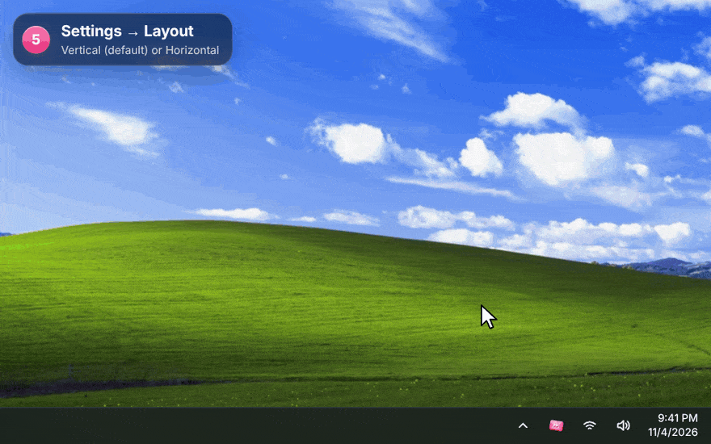

<div align="center">


# Skip Dat

**Every music app's queue, one Alt + scroll away.**

Hold <kbd>Alt</kbd> and scroll anywhere in Windows. A liquid glass wheel of your queue comes out of the cursor.<br>
Let go to play the song you landed on.

<a href="../../releases/latest/download/SkipDat-setup.exe"></a>

<sub>Windows 10 and 11 · about 3 MB · installs without admin rights · <a href="../../releases">all versions</a></sub>

<br>


</div>

<br>

Works with **Spotify, Apple Music, YouTube Music, YouTube, SoundCloud** and other music players, all in one wheel. Chats, calls, social videos and ordinary YouTube videos are left out.

## How to use it

### 1. Install it


1. Download **SkipDat-setup.exe** with the button above, and run it. It installs for your Windows account only, so Windows won't ask for an administrator.
2. If Windows says *"Windows protected your PC"*, click **More info**, then **Run anyway**. That shows up because the installer isn't code-signed yet.
3. Skip Dat starts in the **tray**, next to the clock. The first time, its Settings window opens by itself.

While installing you can also pick a Start menu shortcut, a desktop shortcut and "Start with Windows".

### 2. Hold Alt, scroll, let go


| Do this | What happens |
|---|---|
| **Hold <kbd>Alt</kbd>** and keep holding it | Nothing yet. Alt still works as usual everywhere. |
| **Scroll** the mouse wheel | The wheel opens at your cursor. Each notch moves one song. Scroll down for what's next, up for what already played. |
| **Let go of <kbd>Alt</kbd>** | The song in front plays and the wheel slips back into your cursor. If you didn't move off the song that's playing, nothing changes. |

### 3. While you hold: click, control, switch apps


As long as you hold <kbd>Alt</kbd>, everything on the wheel is clickable:

- **Click any song** to play it straight away.
- **⏮ ⏯ ⏭** beside the wheel go back, play or pause, and skip.
- **Click an app's name** (YouTube Music, Spotify, SoundCloud...) to see that app's queue instead. The highlighted name is the app you're looking at.
- **Close without changing anything**: press <kbd>Esc</kbd> or click anywhere outside the wheel.

<details>
<summary><b>Keyboard and mouse shortcuts while holding</b></summary>

<br>

| | Vertical wheel | Horizontal wheel |
|---|---|---|
| Next / previous song | <kbd>↓</kbd> <kbd>↑</kbd> or the mouse wheel | <kbd>→</kbd> <kbd>←</kbd> or the mouse wheel |
| Switch app | <kbd>→</kbd> <kbd>←</kbd>, <kbd>Tab</kbd>, the mouse's side buttons, or tilting the wheel | <kbd>↓</kbd> <kbd>↑</kbd>, <kbd>Tab</kbd>, the mouse's side buttons, or tilting the wheel |
| Play or pause | <kbd>Space</kbd> or a middle click | <kbd>Space</kbd> or a middle click |
| Play the song in front | <kbd>Enter</kbd> | <kbd>Enter</kbd> |

</details>

### 4. Use your own shortcut


**Double-click the Skip Dat icon in the tray** to open Settings, then choose one under **Shortcut**. It works right away:

- <kbd>Alt</kbd> (the default), <kbd>Ctrl</kbd>, <kbd>Shift</kbd> or the <kbd>Windows</kbd> key
- <kbd>Ctrl</kbd> + <kbd>Alt</kbd>, <kbd>Ctrl</kbd> + <kbd>Shift</kbd> or <kbd>Alt</kbd> + <kbd>Shift</kbd>
- the **right mouse button**, or the mouse's **Back** or **Forward** side button. A normal click or drag with that button still works; it only opens the wheel when you scroll while holding it.

### 5. Vertical or horizontal



In Settings, under **Layout**:

- **Vertical** (the default): the wheel stands beside your cursor.
- **Horizontal**: the songs line up in a row above your cursor (below it near the top of the screen), with the app names above and the buttons underneath.

The change applies at once, with no restart.

### 6. YouTube Music, YouTube and SoundCloud: add the browser companion


Music playing in a browser shows up in the wheel by itself, but only the song that's on. To see the **whole queue** of YouTube Music, YouTube and SoundCloud (playlists, mixes and radio included) and play any song in it, add the small companion extension once. It works in Chrome, Edge, Brave and Opera:

1. Open `chrome://extensions` in a new tab. In Edge it's `edge://extensions`.
2. Turn on **Developer mode**.
3. Click **Load unpacked** and choose the **browser-companion** folder. It's in `%LOCALAPPDATA%\Programs\Skip Dat`, and the **Show folder** button in Settings opens it.
4. Reload any music tab that was already open.

Settings shows **Connected** once a music tab has talked to Skip Dat.

## What it shows for each app

| App | Song that's on | Upcoming songs | Pick a song from the list |
|---|:---:|---|---|
| **YouTube Music** (with the companion) | ✓ | The whole Up next list: albums, playlists, mixes and radio, autoplay included | Plays it directly |
| **YouTube** playlist or mix (with the companion) | ✓ | The playlist or mix, growing as YouTube adds to it | Plays it directly |
| **YouTube** single video (with the companion) | ✓ | The one song autoplay will play next | Skips to it |
| **SoundCloud** (with the companion) | ✓ | The Next up list | Plays it directly |
| **Spotify** app | ✓ | Only with the optional Spotify connection (see below) | Plays it directly when connected, skips otherwise |
| **Apple Music** and other music apps | ✓ | Not shared by the app; you see the songs it played | Skips back through them |
| Music in a browser without the companion | ✓ | — | Skips |

Nothing is made up: when an app doesn't share what's next, the wheel shows what it played and what's on, and a note says so.

## Good to know

- **Spotify's upcoming songs**: open Settings → *Spotify's upcoming songs* and connect a free Spotify developer app (Client ID). Spotify requires the developer app's owner to have Premium.
- **Nothing leaves your PC.** There's no account and no tracking. The companion only talks to Skip Dat on your own computer (`127.0.0.1`).
- **Updating**: run a newer installer. It closes Skip Dat, replaces it and keeps your settings.
- **Removing**: Windows Settings → Apps → Skip Dat → Uninstall. Remove the browser companion from your browser too.
- While a window that runs **as administrator** has focus, Windows doesn't pass the shortcut to normal apps, so the wheel won't open over it.
- **Full-screen games** in exclusive mode draw over everything, including the wheel.
- **Firefox** isn't supported by the companion yet. Its music still shows up, without the queue.

## Build it yourself

Skip Dat is a [Tauri 2](https://tauri.app) app: Rust for the Windows side, and HTML, CSS and WebGL for the wheel and Settings.

1. Install Rust from https://rustup.rs (the default MSVC toolchain) and the **Visual Studio Build Tools** with "Desktop development with C++".
2. In `src-tauri`, run `cargo build --release`. The app is `src-tauri\target\release\skip-dat.exe`, and it needs `WebView2Loader.dll` beside it.
3. In `installer/anim`, run `cargo build --release` for the installer's animation.
4. For the installer, install NSIS 3 and run `installer/build.sh` from Git Bash or WSL.

Releases are cross-compiled from Linux with MinGW (`x86_64-pc-windows-gnu`) and built with NSIS 3.09.

<details>
<summary><b>How the parts fit</b></summary>

```
src-tauri/src/hooks.rs     global input: the shortcut, one step per wheel notch, clicks on the wheel's
                           buttons, Esc / click-away, and a watchdog so the wheel can never get stuck
src-tauri/src/overlay.rs   the transparent, click-through, always-on-top window that never takes focus;
                           photographs the desktop behind it for the glass
src-tauri/src/media.rs     Windows media sessions, driven by Windows' change events
src-tauri/src/browser.rs   local server (127.0.0.1:47231) for the browser companion, extension-only
src-tauri/src/classify.rs  what is music and what isn't (unit-tested)
src-tauri/src/view.rs      builds each app's real song list; pushes updates only when they change
src-tauri/src/actions.rs   plays, skips and jumps, one at a time in order
src-tauri/src/art.rs       album art store, served to the windows as skipart://<id>
src-tauri/src/spotify.rs   optional Spotify sign-in (PKCE, no secret stored) for its upcoming songs
browser-companion/         the Chrome / Edge extension: page.js reads the page, bridge.js and
                           background.js carry messages to the app
ui/overlay.js              WebGL renderer and motion; vertical and horizontal layouts
ui/settings.html           Settings: playing now, shortcut, layout, companion, hidden apps, options
installer/                 the NSIS installer and its animation helper (installer/anim)
branding/                  the icon and installer art, drawn by script
docs/media/                the pictures and GIFs on this page
```

</details>

<br>

<sub>The songs in the demos are examples, and their covers are doodles made for the demo, not the real artwork. The desktop in the demos is Windows XP's "Bliss" wallpaper (photo by Charles O'Rear, © Microsoft).</sub>
