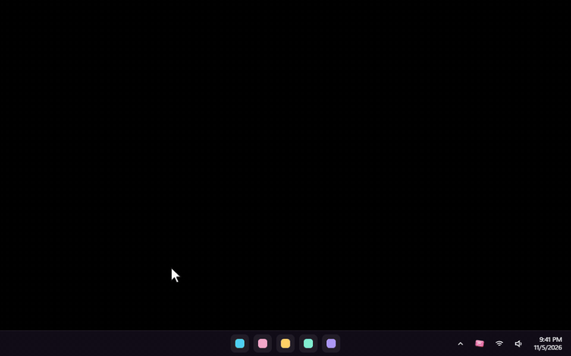
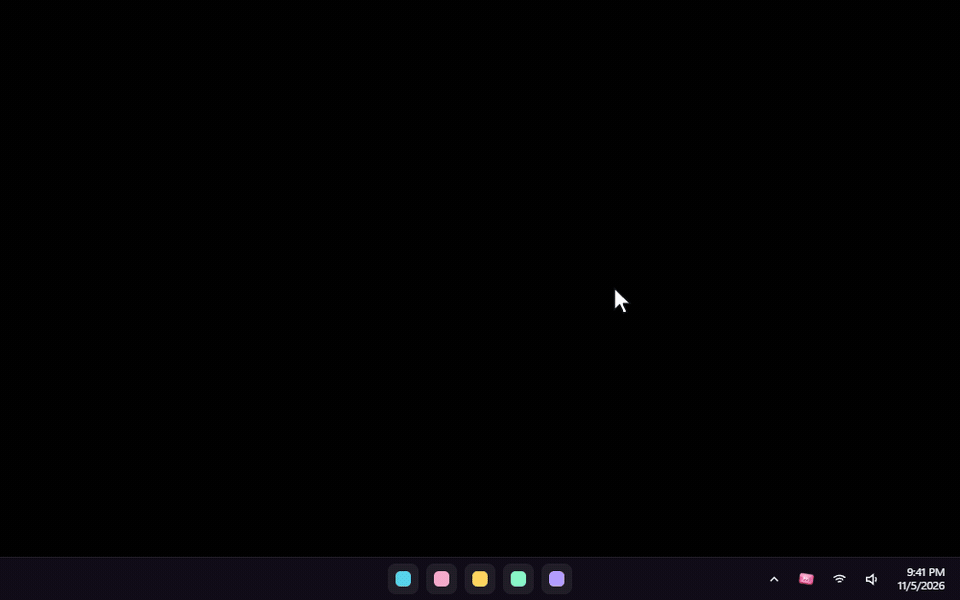
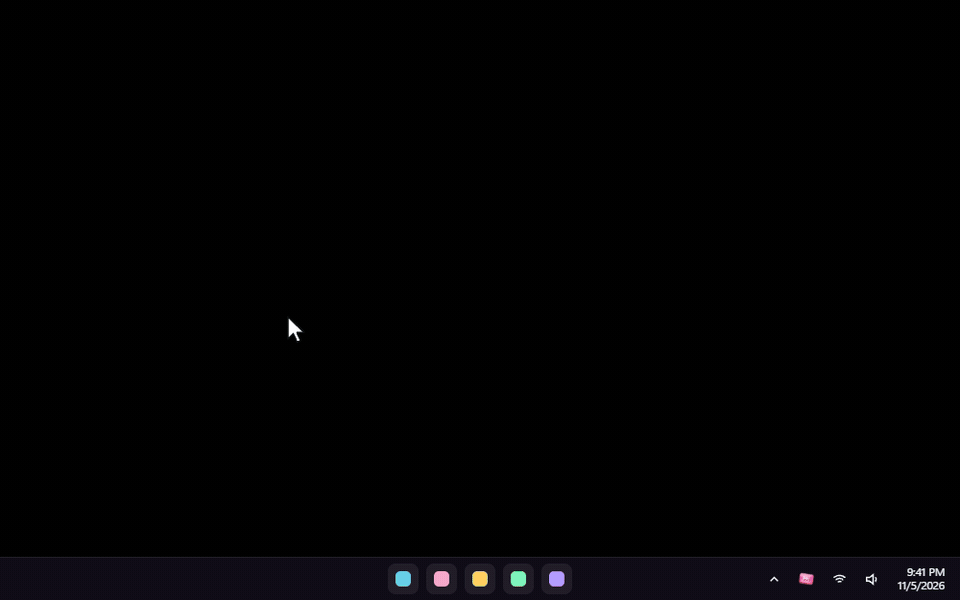

<div align="center">


# Skip Dat

**Every music app's queue, one Alt + scroll away.**

Hold <kbd>Alt</kbd> and scroll anywhere in Windows. A glass wheel of your queue pops out of the cursor.<br>
Let go to play the song you landed on. That's it. That's the app.

<a href="../../releases/latest/download/SkipDat-setup.exe"></a>

<sub>Version 1.5.2 · Windows 10 and 11 · about 4 MB · installs without admin rights · <a href="../../releases">all versions</a></sub>

<br>


</div>

<br>

Works with **Spotify, Apple Music, YouTube Music, YouTube, SoundCloud** and other music players, all in one wheel. Chats, calls, social videos and ordinary YouTube videos are left out.

## New in 1.5

### Volume and jumping, right on the wheel


- **Scroll over play/pause** to turn the playing app up or down, 5% a notch. Desktop apps change only their own slider in Windows' volume mixer; YouTube and YouTube Music change only that tab.
- **Scroll over the song playing** to jump forward or back 10 seconds a notch.
- SoundCloud's volume and position only move with its own controls, and Skip Dat says so.

### Like, copy, play next



A row of buttons under the play controls:

- **Like** adds the song to Spotify's Liked Songs, or presses Like on YouTube, YouTube Music and SoundCloud. **It never unlikes**: a song that's already liked stays liked, and the heart shows it.
- **Copy link** copies the song's open.spotify.com link, or the page of the song playing in your browser.
- **Play next** puts a Spotify song straight after the one playing, without restarting anything.
- A button the playing app can't do is dimmed, and clicking it says why.

### Continue on Spotify


Heard something on YouTube Music, YouTube or SoundCloud? **Continue on Spotify** finds the same song on Spotify and starts it at about the same moment. The original pauses only once Spotify is really playing. If Spotify can't find or start it, nothing is paused.

### Freaky Random


A new style. The song in front is big and sharp; the rest float round it in a ring, the next one always closest, the further ones smaller and blurrier. Each notch glides every card one place along the ring. Point at a card to lift it, click it to play it. The ring takes a new shape every time it opens.

### Settings floats



Settings has no window frame or background any more: only its glass panels, floating over your desktop. Drag it by the top card, which has its own minimize and close buttons, and click straight through the gaps to whatever is behind. **Look** and **Skin** each open in their own glass panel: **Change**, or <kbd>Ctrl</kbd> + <kbd>L</kbd> and <kbd>Ctrl</kbd> + <kbd>K</kbd>.

### Liquid Glass in your own colour



A colour slider under **Liquid Glass** tints the glass any colour. It stays glass, with its blur, light and depth, and the text stays easy to read. **Original** puts the clear glass back.

### New and reworked skins

**Bubble Gum** (8-bit; its bubble pops when you skip), **Quicksilver** (liquid mercury with a drip that falls), **Bare Knuckle** (a basement-fight mood) and **Claude-ish** (cream paper and a spark that keeps turning) are new, and every built-in skin got finer art and calmer motion. See [Styles and skins](#styles-and-skins).

> **Spotify users coming from 1.4**: press **Reconnect** once under Spotify in Settings, so Like and Continue on Spotify can use your Liked Songs.

Everything else is in [CHANGELOG.md](CHANGELOG.md).

## How to use it

### 1. Install it


1. Download **SkipDat-setup.exe** with the button above and run it. It installs for your Windows account only, so Windows won't ask for an administrator.
2. If Windows says *"Windows protected your PC"*, click **More info**, then **Run anyway**. That shows up because the installer isn't code-signed yet.
3. Skip Dat starts in the **tray**, next to the clock. The first time, its Settings window opens by itself.

While installing you can also pick a Start menu shortcut, a desktop shortcut and "Start with Windows".

### 2. Hold Alt, scroll, let go


| Do this | What happens |
|---|---|
| **Hold <kbd>Alt</kbd>** and keep holding it | Nothing yet. Alt still works as usual everywhere. |
| **Scroll** the mouse wheel | The wheel opens at your cursor. Each notch moves one song. Scroll down for what's next, up for what already played. |
| **Let go of <kbd>Alt</kbd>** | The song in front plays and the wheel slips back into your cursor. If you didn't move off the song that's playing, nothing changes. |

### 3. While you hold: click, control, switch apps


As long as you hold <kbd>Alt</kbd>, everything on the wheel is clickable:

- **Click any song** to play it straight away.
- **Previous, play/pause and next** beside the wheel do what they say. Scroll over play/pause for the volume.
- **Like, Copy link, Play next, Continue on Spotify** sit in the row under them.
- **Back to …** takes you to the song you were on before your last skip or jump.
- **Click an app's name** (YouTube Music, Spotify, SoundCloud...) to see that app's queue instead. The highlighted name is the app you're looking at.
- **Close without changing anything**: press <kbd>Esc</kbd> or click anywhere outside the wheel.

<details>
<summary><b>Keyboard and mouse shortcuts while holding</b></summary>

<br>

| | Vertical wheel | Horizontal wheel |
|---|---|---|
| Next / previous song | <kbd>↓</kbd> <kbd>↑</kbd> or the mouse wheel | <kbd>→</kbd> <kbd>←</kbd> or the mouse wheel |
| Switch app | <kbd>→</kbd> <kbd>←</kbd>, <kbd>Tab</kbd>, the mouse's side buttons, or tilting the wheel | <kbd>↓</kbd> <kbd>↑</kbd>, <kbd>Tab</kbd>, the mouse's side buttons, or tilting the wheel |
| Play or pause | <kbd>Space</kbd> or a middle click | <kbd>Space</kbd> or a middle click |
| Play the song in front | <kbd>Enter</kbd> | <kbd>Enter</kbd> |
| Volume | the mouse wheel over play/pause | the mouse wheel over play/pause |
| Jump 10 seconds | the mouse wheel over the song in front | the mouse wheel over the song in front |

</details>

### 4. Spotify jumps, and Back to …


Pick a Spotify song four places down and Skip Dat jumps **straight to it**: you don't hear the songs in between, not even muted. It starts the song inside the playlist or album you're playing, and that list carries on as usual. This needs the optional **Spotify connection** (see [Good to know](#good-to-know)). Spotify can't start some lists (Liked Songs, artists, radio) at a particular song; for those, Skip Dat plays your song followed by the songs shown after it.


**Back to …** under the play/pause button is undo for music: it shows the song you were playing before your last skip or jump. Click it to go straight back, and again to return.

### 5. Use your own shortcut


**Double-click the Skip Dat icon in the tray** to open Settings, then choose one under **Shortcut**. It works right away:

- <kbd>Alt</kbd> (the default), <kbd>Ctrl</kbd>, <kbd>Shift</kbd> or the <kbd>Windows</kbd> key
- <kbd>Ctrl</kbd> + <kbd>Alt</kbd>, <kbd>Ctrl</kbd> + <kbd>Shift</kbd> or <kbd>Alt</kbd> + <kbd>Shift</kbd>
- the **right mouse button**, or the mouse's **Back** or **Forward** side button. A normal click or drag with that button still works; it only opens the wheel when you scroll while holding it.

### 6. What was I playing?


Right-click Skip Dat in the tray (or open Settings) and choose **What was I playing?** It lists the songs you listened to, newest first, with the app, the time and the cover. Click one to play it again. A song counts once it has played for a few seconds; songs Skip Dat only skipped past don't count. The list stays on your PC, and **Clear history** empties it.

### 7. YouTube Music, YouTube and SoundCloud: add the browser companion


Music playing in a browser shows up in the wheel by itself, but only the song that's on. To see the **whole queue** of YouTube Music, YouTube and SoundCloud (playlists, mixes and radio included), play any song in it, and use volume, jumping and Like on that tab, add the small companion extension once. It works in Chrome, Edge, Brave and Opera:

1. Open `chrome://extensions` in a new tab. In Edge it's `edge://extensions`.
2. Turn on **Developer mode**.
3. Click **Load unpacked** and choose the **browser-companion** folder. It's in `%LOCALAPPDATA%\Programs\Skip Dat`, and the **Show folder** button in Settings opens it.
4. Reload any music tab that was already open.

Settings shows **Connected** once a music tab has talked to Skip Dat. After updating Skip Dat, press the companion's reload button on the extensions page once.

## Styles and skins


In Settings, press **Change** next to **Look** (or <kbd>Ctrl</kbd> + <kbd>L</kbd>):

- **Style**: **Wheel** (cards on a turning drum, the default), **Stack** (a flat list of cards), **Cover flow** (a row, turned to face you), **Orbit** (a tilted ring round your cursor), **Compact** (just the titles, small) or **Freaky Random** (the song in front is big; the rest float round it in a ring).
- **Wheel direction**, for the Wheel: **Vertical** stands beside your cursor; **Horizontal** lines the songs up in a row above it.
- **Size**: Small, Medium (the default) or Large.
- **Depth**: how much the songs away from the middle **blur** and **fade**. Both at 0 keeps every card sharp.


Press **Change** next to **Skin** (or <kbd>Ctrl</kbd> + <kbd>K</kbd>):

- **Liquid Glass**: the default, frosted glass over your desktop. The colour slider under it tints the glass your way.
- **Lime Pod**: glossy lime plastic and a swaying chrome antenna, a 2000s media player look.
- **LCD Night**: a green pocket-player screen with scanlines and a battery that charges.
- **Brushed Chrome**: brushed metal, real screws and a breathing pink LED.
- **Pixel Party**: an 8-bit cave, with grass and a pickaxe on top and a burning torch.
- **Quicksilver**: liquid mercury along the card's edge, with a drip that gathers and falls.
- **Bare Knuckle**: a basement under green fluorescent light: a bloodied hand wrap, a typed rules note, a bar of pink soap, a swinging bare bulb, and a flicker of old film on every song change.
- **Bubble Gum**: an 8-bit gum wrapper whose bubble blows up and pops, and pops straight away when you skip.
- **Claude-ish**: warm cream paper, a serif title, terracotta buttons and a spark that slowly turns, like Claude thinking. An unofficial fan skin.

Every change applies at once, with no restart.

**Make your own**: a skin is a folder with a `skin.json` file, plus any pictures and fonts it uses. Pictures can swing, breathe, flicker or play when the song changes. **Open skins folder** in the Skin panel takes you there, and a starter skin is waiting in it. Skip Dat watches the folder, so the carousel updates as you save. Everything you can change is in [SKINS.md](SKINS.md).

## What it shows for each app

| App | Song that's on | Upcoming songs | Pick a song from the list |
|---|:---:|---|---|
| **YouTube Music** (with the companion) | ✓ | The whole Up next list: albums, playlists, mixes and radio, autoplay included | Plays it directly |
| **YouTube** playlist or mix (with the companion) | ✓ | The playlist or mix, growing as YouTube adds to it | Plays it directly |
| **YouTube** single video (with the companion) | ✓ | The one song autoplay will play next | Skips to it, muted on the way |
| **SoundCloud** (with the companion) | ✓ | The Next up list | Plays it directly (with shuffle on, skips to it muted, so the shuffle order stays) |
| **Spotify** app | ✓ | Only with the optional Spotify connection (see below) | Jumps straight to it when connected, inside your playlist or album; skips to it muted otherwise |
| **Apple Music** and other music apps | ✓ | Not shared by the app; you see the songs it played | Skips back through them, muted on the way |
| Music in a browser without the companion | ✓ | — | Skips, muted on the way |

Nothing is made up: when an app doesn't share what's next, the wheel shows what it played and what's on, and a note says so.

When Skip Dat has to press next or previous several times to reach your song, it mutes that one app (only that app, through Windows' volume mixer) until your song starts, so you don't hear the songs in between. Your queue and shuffle order stay as they were, minus the songs you skipped.

## Good to know

- **The Spotify connection** (Settings → *Spotify's upcoming songs*) gives Spotify's upcoming songs, straight jumps, Like, Play next and Continue on Spotify. Connect a free Spotify developer app (Client ID); Spotify requires the developer app's owner to have Premium. Anything Spotify refuses is written to `skipdat.log`.
- **Performance mode** (Settings → Options), for gaming and slower PCs: no blur, glass, shadows, animations, skin pictures or album art. When the carousel is closed, Skip Dat lets go of its graphics memory in every mode.
- **Animations off**: with Windows' "Show animations" off, the carousel moves without its float and skin pictures hold still.
- **Settings has no title bar**: drag it by the top card. <kbd>Alt</kbd> + <kbd>F4</kbd> closes it too, and the tray icon always opens it again.
- **Nothing leaves your PC.** There's no account and no tracking. The companion only talks to Skip Dat on your own computer (`127.0.0.1`), and your listening history stays in Skip Dat's folder.
- **Updating**: run a newer installer. It closes Skip Dat, replaces it and keeps your settings, skins and history. If you use the browser companion, click its reload button on the extensions page afterwards.
- **If something goes wrong**, `skipdat.log` in `%APPDATA%\app.skipdat.desktop` says what happened, crashes included. Attach it to an issue.
- **Removing**: Windows Settings → Apps → Skip Dat → Uninstall. Remove the browser companion from your browser too.
- While a window that runs **as administrator** has focus, Windows doesn't pass the shortcut to normal apps, so the wheel won't open over it.
- **Full-screen games** in exclusive mode draw over everything, including the wheel.
- **Firefox** isn't supported by the companion yet. Its music still shows up, without the queue.

## Build it yourself

Skip Dat is a [Tauri 2](https://tauri.app) app: Rust for the Windows side, and HTML, CSS and WebGL for the wheel and Settings.

1. Install Rust from https://rustup.rs (the default MSVC toolchain) and the **Visual Studio Build Tools** with "Desktop development with C++".
2. In `src-tauri`, run `cargo build --release`. The app is `src-tauri\target\release\skip-dat.exe`.
3. In `installer/anim`, run `cargo build --release` for the installer's animation.
4. For the installer, install NSIS 3 and run `installer/build.sh` from Git Bash or WSL.

<details>
<summary><b>How the parts fit</b></summary>

```
src-tauri/src/hooks.rs     global input: the shortcut, one step per wheel notch, clicks on the wheel's
                           buttons, Esc / click-away, and a watchdog so the wheel can never get stuck
src-tauri/src/overlay.rs   the transparent, click-through, always-on-top window that never takes focus;
                           photographs the desktop behind it for the glass
src-tauri/src/media.rs     Windows media sessions, driven by Windows' change events; jumping within a song
src-tauri/src/browser.rs   local server (127.0.0.1:47231) for the browser companion, extension-only
src-tauri/src/classify.rs  what is music and what isn't (unit-tested)
src-tauri/src/view.rs      builds each app's real song list; pushes updates only when they change
src-tauri/src/actions.rs   plays, skips and jumps, one at a time in order; Back to; replays from the history
src-tauri/src/extras.rs    volume, jumping within a song, Like, Copy link, Play next, Continue on Spotify
src-tauri/src/plan.rs      how to reach a song on each player: jump, muted skip, or leave it (unit-tested)
src-tauri/src/audio.rs     one app's slider in Windows' volume mixer: muting while skipping, volume
src-tauri/src/history.rs   "What was I playing?", kept in a local file (unit-tested)
src-tauri/src/skins.rs     built-in and user skins, the skins folder watcher, skipskin:// files
src-tauri/src/float.rs     the floating Settings window: clicks between its panels pass through
src-tauri/src/util.rs      crash-proof locks and the log (skipdat.log, beside the settings)
src-tauri/src/art.rs       album art store, served to the windows as skipart://<id>
src-tauri/src/spotify.rs   optional Spotify sign-in (PKCE, no secret stored) and its Web API calls
browser-companion/         the Chrome / Edge extension: page.js reads and drives the player, bridge.js
                           and background.js carry messages to the app
ui/overlay.js              WebGL renderer and motion; the styles, depth, skins and performance mode
ui/settings.html           Settings: playing now, shortcut, the Look and Skin panels, companion, options
ui/history.html            the "What was I playing?" window
ui/skins/                  the built-in skins; SKINS.md explains the format
installer/                 the NSIS installer and its animation helper (installer/anim)
branding/                  the icon and installer art, drawn by script
docs/                      this page as a website (index.html), its pictures and GIFs (media/)
docs/recorder/             records those GIFs from the real carousel code (see its README)
```

</details>

<br>

If Skip Dat is useful to you, you can [buy me a coffee](https://buymeacoffee.com/ffoouuaadd). There's a button in Settings too.

## Credits

The GIFs show Skip Dat's real carousel, recorded with real albums that their artists released under Creative Commons, shown with their real covers. Go listen to them, they're free.

- **Nine Inch Nails**: [*The Slip*](https://archive.org/details/nine_inch_nails_the_slip) and [*Ghosts I–IV*](https://archive.org/details/nineinchnails_ghosts_I_IV), licensed [CC BY-NC-SA 3.0 US](https://creativecommons.org/licenses/by-nc-sa/3.0/us/).
- **Released by Bad Panda Records** under [CC BY-NC-SA 3.0](https://creativecommons.org/licenses/by-nc-sa/3.0/):
  - Memotone, [*Bad Panda EP*](https://archive.org/details/badpanda096)
  - Ben Mason, [*Easy / Never*](https://archive.org/details/badpanda074)
  - Kodak To Graph, [*Visiol EP*](https://archive.org/details/badpanda105)
  - Dumbo Gets Mad, [*Eclectic Prawn*](https://archive.org/details/badpanda049) and [*You Make You Feel*](https://archive.org/details/badpanda082)
  - The Parish of Little Clifton, [*Septemberish*](https://archive.org/details/badpanda098)
  - Handbook, [*Been A While Since You Spoke*](https://archive.org/details/badpanda100)
  - Iròi, [*Where You Were Now*](https://archive.org/details/badpanda089)
  - The Underscore Orkestra, [*Balancing Act*](https://archive.org/details/badpanda009)
  - Ghostly Dust Machine, [*Ode To A Baby Snowstorm*](https://archive.org/details/badpanda079)
  - Berlinist, [*My Darling Grace*](https://archive.org/details/badpanda081)
- The covers are shown as released, cropped square. Because they're NonCommercial-ShareAlike, **the GIFs on this page are shared under [CC BY-NC-SA 3.0](https://creativecommons.org/licenses/by-nc-sa/3.0/)** too.
- The desktop in the demos is plain black; the meme captions and stickers were made for them. All skin art is original.
- Skip Dat isn't affiliated with Spotify, YouTube, SoundCloud, Apple, Anthropic, Bad Panda Records or any artist named here. Claude-ish is an unofficial fan skin.
